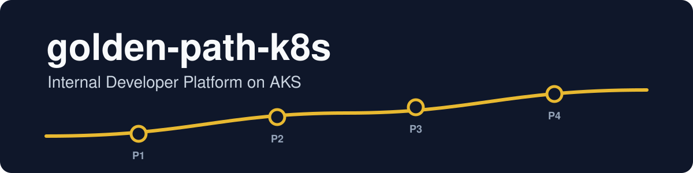

---

**A versioned Developer Contract on AKS: four promises to app teams, each guarantee tied to the check that proves it.**

<a href="https://github.com/joezuchora/golden-path-k8s/actions/workflows/pr-checks.yaml"></a>
<a href="docs/developer-contract.md"></a>
<a href="charts/golden-service/Chart.yaml"></a>
<a href="docs/adr/README.md#version-pins"></a>
<a href="docs/adr/0003-cilium-ebpf-and-gateway-api.md"></a>

A public, production-grade reference Internal Developer Platform (IDP) on AKS. An app team writes one values file,
`apps/<app>/<env>.yaml`, with `app`, `env` and a signed `image` digest, and ships by merging a pull request. Team, owner,
cost center, labels, tags and identity are derived from the team's file (D-017). In return the platform keeps the
[Developer Contract](docs/developer-contract.md): P1 a place to run · P2 an identity · P3 a way to see what it's doing ·
P4 a safe way to ship. Nobody runs `kubectl apply`, nobody needs `cluster-admin`, and a rejected change says what
failed, why, and how to fix it.

It is organized around one idea from the AKS Engineering Blog: "tools shouldn't dictate your developer contract; they
should fulfill it" (F17). The 4 promises come from the blog (F2, F16). Every component exists to fulfill one promise, is
measured against the CNCF capability domains, and names the AKS-native alternative it was weighed against. **Cilium,
Chainguard and Cosign are this repo's extensions; the blog doesn't mention them (F1, D-015).**

> **Status: Phase 3 of 6. The platform runs on kind: every Phase 3 journey (J1–J4, O1) and platform check passes there
> (`make e2e-all`); Phase 4 (AKS) is in progress: Terraform and the cloud preflight are built and validated locally, with no live
> Azure run yet ([tracker](docs/adr/README.md#phase-4-exit-criteria-tracker-d-087)).** Quickstarts not yet available are marked *Planned*. Every decision, including reversed ones, is in the [Decision Log](docs/adr/README.md) and
> [design evolution](docs/design-evolution.md). What comes next: [roadmap](ROADMAP.md); gotchas already solved:
> [known issues](docs/known-issues.md).

## Contents

- [Why](#why)
- [How it works](#how-it-works)
- [Try it](#try-it)
- [Compatible with](#compatible-with)
- [Getting started](#getting-started)
- [Developer Contract Matrix](#developer-contract-matrix)
- [CNCF capability-domain coverage](#cncf-capability-domain-coverage)
- [Documentation](#documentation)
- [Architecture](#architecture)
- [Sources](#sources)
- [Contributing](#contributing)

## Why

A platform defined by its tools changes its interface whenever a tool changes. This one fixes the interface first: the
contract v1 surface is `charts/golden-service` 1.x, the Crossplane XRDs at `v1`, `reusable-build-sign.yaml@v1` and
Kyverno policy set v1 (D-014). The tools behind it can change; a breaking change to the surface needs a major version, an
ADR and a migration guide ([ADR-0010](docs/adr/0010-contract-versioning.md)).

Every claim is meant to be checkable. Each guarantee in the contract names the fitness check that proves it, and stays
*designed* until that check passes. Every phase is proven on kind at zero cost before it runs on AKS (D-016). Every
decision, including the reversed ones, is logged with its options, its rationale and the AKS-native alternative.

## How it works

```
PR: apps/<app>/<env>.yaml ─merge─→ Argo CD sync ─→ Kyverno admission ─→ rollout ─→ HTTPRoute (HTTPS)
    ↑                                   │          signer + caller +       │
    │                                   ↓          base digest             │
    │                   XR in tenant namespace             │ deny          │ unhealthy
    │                   → Crossplane composition           ↓               ↓
    │                   → Ready: the app connects    commit status, PolicyReport, idp-diagnose
    │                                                      │
    └───────────────── fix through Git ← ──────────────────┘
```

1. **Build.** The app's repo calls `reusable-build-sign.yaml@v1`, which verifies the Chainguard base, builds, scans with
   Trivy, signs keyless with Cosign, and attests an SPDX SBOM and SLSA provenance to GHCR
   ([ADR-0005](docs/adr/0005-chainguard-images-and-cosign-enforcement.md)).
2. **Declare.** The team opens a PR with its `golden-service` values (optional route, dependency and network values
   included) and, for a dependency, an XR.
3. **Sync.** On merge, Argo CD syncs the change inside the team's AppProject. Placement selects clusters by capability
   label, never by name (D-023).
4. **Admit.** Kyverno binds three things before a pod runs: the signer (the pinned reusable workflow), the caller repo and
   ref (from signed provenance), and the exact base digest. It fails closed (D-026).
5. **Provision.** The XR lives in the control cluster's `tenant-<team>-<env>` namespace. A Crossplane v2 composition
   (`local` on kind, `azure` on AKS) creates the dependency, and its credential flows composed Secret → ESO `PushSecret` →
   Key Vault → `ExternalSecret`. "Ready" means the app connects, survives a rotation, and leaves nothing behind (D-024).
6. **Roll out.** The `golden-service` chart renders the app and its `HTTPRoute`; the merge commit gets a green status.
7. **Recover through Git.** An admission denial comes back as a red commit status and a `PolicyReport` with what failed,
   why, the fix and a docs link; values that don't render are reported on the attempted commit (D-075). For an
   unhealthy rollout or a stalled XR, `scripts/idp-diagnose.sh` shows every failure signal in one namespace-scoped
   command. The fix is another PR, not cluster access.

Tenant isolation is enforced at each backend, never by filtering a UI (D-025), and cross-tenant access is tested to be
denied.

## Try it

A five-minute tour of what the platform proves, each stop with its journey page and suite:

| Stop | What it shows | Where |
|---|---|---|
| 1. Ship by merging a PR | PR → Argo CD sync → signed-image admission → HTTPS route → green commit status on the merge commit. Nobody runs `kubectl apply` | [J1](docs/journeys/j1-ship.md) · `tests/e2e/j1-ship/` |
| 2. A rejected change tells you how to fix it | An unsigned image, a raw manifest or bad values gets a red commit status with what failed, why, the fix and a docs link. The fix is another PR, not cluster access | [J2](docs/journeys/j2-rejected-change.md) · `tests/e2e/j2-rejected-change/` |
| 3. Self-service dependencies | One PostgreSQL XR API with two backends: CloudNativePG on kind, and Flexible Server on AKS (proven statically so far). The app connects, survives a credential rotation, and leaves nothing behind | [J4](docs/journeys/j4-request-database.md) |
| 4. Onboarding is one reviewed file | `platform/tenancy/teams/<team>.yaml` creates the team's namespaces, RBAC, quota, default-deny network policy, admission policies and Argo CD project. Cross-tenant access is tested to be denied | [O1](docs/journeys/o1-onboard-team.md) |
| 5. Decisions are traceable | 100+ logged decisions and 15 ADRs, with every reversal kept along with its reason | [Decision Log](docs/adr/README.md) · [design evolution](docs/design-evolution.md) |

**Proof, not prose:** every code PR to `main` runs each journey suite on its own fresh kind platform in CI (`kind-e2e`,
a required check), and every Kyverno policy has pass and fail tests. To run it yourself on kind (Docker with 8 GiB or
more; prerequisites under [Getting started](#getting-started)):

```bash
make doctor                      # prerequisites (PROFILE=local|docs|github|cloud|all)
make kind-up                     # Docker required; on Windows use WSL2 or Git Bash
make validate                    # static checks
make test-policies               # kyverno test for every policy (needs network: F35)
make e2e JOURNEY=<journey-dir>   # one Chainsaw suite on kind, e.g. j1-ship; make e2e-all runs all seven
make kind-down
```

## Compatible with

✅ Available today · 🗺️ Planned, with the phase that delivers it · ❌ Not in v1

**Cluster profile.** Apps depend only on `HTTPRoute` and `CiliumNetworkPolicy`; the profile changes the `GatewayClass` and
the dataplane, not the app's manifests (D-005, D-027):

| Profile | Gateway and CNI | Status |
|---|---|---|
| kind (local, every PR) | Cilium Gateway, OSS Cilium | ✅ Available (Phase 3): the platform, the policy set and every journey run locally |
| AKS, `cilium_mode = managed` (default) | Envoy Gateway, Azure CNI Powered by Cilium | 🗺️ Planned (Phase 4): Terraform and the cloud preflight built and validated locally; no live Azure run yet |
| AKS, `cilium_mode = byo` | Cilium Gateway, OSS Cilium | 🗺️ Planned (Phase 4): clusters are created without a CNI; the OSS Cilium install on AKS isn't built yet, and it runs after `managed` passes |

AKS support is declared only after the network contract suite passes on `managed` and `byo` (D-027) and the identity
allow/deny gate passes (ADR-0008).

**PostgreSQL backend.** One `PostgreSQLInstance` XR API, one composition per backend (D-024):

| Backend | Status |
|---|---|
| CloudNativePG (`local` composition) | ✅ Available (Phase 3): proven on kind (J4) |
| Azure Database for PostgreSQL Flexible Server (`azure` composition) | 🗺️ Planned (Phase 4): validated and render-tested, not yet run on Azure |
| Dependencies other than PostgreSQL | ❌ Not in v1 (ADR-0002 catalog expansion) |

**Opt-in add-ons.** Off by default, so the baseline has no extra cost:

| Add-on | Status |
|---|---|
| Azure Front Door Premium + WAF with origin lock (`enable_edge_waf`, D-007) | 🗺️ Planned (Phase 4): the flag is refused until its Terraform module exists |
| L7/FQDN policy profile: ACNS on `managed`, OSS Cilium on `byo` and kind (D-021) | 🗺️ Planned (Phase 4): not exercised on kind yet |

## Getting started

Start with **[docs/getting-started.md](docs/getting-started.md)** and `make doctor`, which checks every prerequisite (D-056):
a Linux-container engine with at least 8 GiB of memory, cgroup v2 and kernel 5.14 or later, bash 4 or later, GNU make 4 or
later, and outbound HTTPS. `make tools` installs every other CLI at its pinned, checksum-verified version (D-048,
[toolchain](docs/toolchain.md)). Then follow [Try it](#try-it); the journeys are described in
[docs/journeys/](docs/journeys/README.md).

**AKS: *Planned (Phase 4).*** Built and validated locally only, with no live Azure run yet; don't treat these commands as
a working path until the [Phase 4 tracker](docs/adr/README.md#phase-4-exit-criteria-tracker-d-087) shows live evidence.

```bash
terraform -chdir=infra/envs/<env> init
terraform -chdir=infra/envs/<env> plan   # cilium_mode = managed (default) | byo; enable_edge_waf = false (default)
```

## Developer Contract Matrix

Each component maps to exactly one promise. "AKS-native trade-off" is the managed option the component was weighed
against, and why it wasn't chosen as the default.

| Promise | Component | Why chosen | AKS-native trade-off | CNCF domain |
|---|---|---|---|---|
| P1 A place to run | AKS Standard control + workload clusters | Crossplane and cloud credentials stay off workload clusters; platform upgrades go first (D-002, [ADR-0001](docs/adr/0001-control-and-workload-cluster-split.md)) | AKS Automatic workload clusters (the blog's default, F17) document only Standard as supporting "Bring your own CNI" (F23), which `cilium_mode = byo` needs; Fleet Manager is the documented scale-out path | Infrastructure services |
| P1 A place to run | kind (local profile) | Each phase is proven at zero cost before AKS (D-016) | Dev AKS clusters cost money and are slower to iterate on | Infrastructure services |
| P1 A place to run | Argo CD placement (cluster Secrets + capability labels) | Each ApplicationSet selects one capability label; the in-cluster target is a declarative Secret (D-023) | Fleet Manager resource placement | Automation for delivering and verifying services |
| P1 A place to run | Tenancy render (`platform/tenancy/teams/<team>.yaml`) | One reviewed file creates the team's namespaces, RBAC and ownership labels (D-017, D-028) | Managed namespaces with quota, network policy and RBAC (F16) | Infrastructure services |
| P1 A place to run | Crossplane v2 (namespaced XRDs + function pipelines, `provider-upjet-azure`) | Declarative, continuously reconciled self-service API that also runs on kind (D-003 → D-024, [ADR-0002](docs/adr/0002-crossplane-v2-external-resources.md)) | ASO alone exposes raw Azure resources; kro is "still pre-1.0" (F17) | APIs for automatically provisioning capabilities |
| P1 A place to run | PostgreSQL compositions (`azure`: Flexible Server; `local`: CloudNativePG) | One XRD API with two backends; "Ready" means the app connects, survives rotation, and cleans up (D-024) | Azure Database for PostgreSQL through ASO, with no abstraction layer | Data services |
| P1 A place to run | Backstage dependency catalog (`request-database` template, `dependency:renderRequest`) | A service owner picks a service, environment and approved offering; owner, deploy repository and destination are derived from reviewed metadata and the signed-in user, and placement fails closed (D-101, [ADR-0014](docs/adr/0014-subscription-placement-and-vending.md)). Local preview only: it renders the request file and publishes nothing | Direct Azure portal or CLI access, which bypasses the platform's ownership and placement checks | Web portals for provisioning and observing capabilities |
| P1 A place to run | Cilium CNI (`managed`: Azure CNI Powered by Cilium; `byo`/kind: OSS Cilium) | Microsoft-supported CNI by default; full Cilium as an opt-in (D-005, [ADR-0003](docs/adr/0003-cilium-ebpf-and-gateway-api.md)) | Managed Cilium allows only label-exclusion changes (F3) | Infrastructure services |
| P1 A place to run | `CiliumNetworkPolicy` default-deny baseline (L3/L4) | The app's network boundary, provable for free on kind and managed AKS (D-021, D-027, D-029) | Managed-namespace network policy (F16) | Security services |
| P1 A place to run | Terraform (`infra/`) | The owner's choice for platform foundations; one pinned, checksum-locked CLI (D-088, [ADR-0009](docs/adr/0009-terraform-for-aks-foundations.md)) | Bicep / AVM | Infrastructure services |
| P2 An identity | Entra Workload ID with one UAMI per app per env (`AppIdentity` XR) | No stored secret; per-app blast radius; provable allow/deny (D-022, [ADR-0008](docs/adr/0008-application-workload-identity.md)) | This *is* the AKS-native path; the platform adds per-app scoping and lifecycle | Identity and secret services |
| P2 An identity | External Secrets Operator + Key Vault (`PushSecret` → `ExternalSecret`) | Brokers connection details across the cluster split (ADR-0002) | Workload identity directly, which is preferred wherever the dependency supports Entra auth (ADR-0008) | Identity and secret services |
| P2 An identity | Reloader | Restarts the app when a brokered credential rotates (ADR-0002) | — | Identity and secret services |
| P2 An identity | Gateway API v1.6.1: Envoy Gateway (`managed`), Cilium Gateway (`byo`, kind) | Retired Ingress-NGINX ruled out (F10); both controllers pass v1.6.1 conformance (F14); the feature set is tested, not assumed (D-006, D-027) | Application routing with the Gateway API (F16) is managed but less portable | Infrastructure services |
| P2 An identity | cert-manager | HTTPS certificate for every listener (ADR-0004) | Application routing (F16) | Identity and secret services |
| P2 An identity | ExternalDNS | DNS records for each `HTTPRoute` host (ADR-0004) | Application routing (F16) | Infrastructure services |
| P2 An identity | Azure Front Door Premium + WAF (opt-in, `enable_edge_waf`) | Managed rules and origin lock behind one flag, with no default cost (D-007, [ADR-0004](docs/adr/0004-edge-security-and-waf.md)) | This is AKS-native; OSS Coraza puts rule tuning on the platform team | Security services |
| P2 An identity | ACNS L7/FQDN policy profile (optional; `managed` only) | L7 and FQDN policy on managed Cilium require ACNS (F3); kept optional so the baseline stays free (D-021) | This is AKS-native; it's free with OSS Cilium on `byo` and kind | Security services |
| P3 A way to see what it's doing | Backstage (Kubernetes plugin, `aks` auth on AKS) | A full runnable portal (D-011); per-user Kubernetes RBAC applies (D-025, [ADR-0006](docs/adr/0006-self-service-diagnostics-and-rbac.md)) | AKS desktop, scoped to a namespace (F17); "You can find what's available" isn't built in (F16) | Web portals for provisioning and observing capabilities |
| P3 A way to see what it's doing | Prometheus | Metrics that can be scoped per namespace through a proxy (D-025) | Managed Prometheus access is per workspace or cluster, not per namespace (F8) | Application observability |
| P3 A way to see what it's doing | Grafana (one org per team) + prom-label-proxy | OSS tenant isolation; Viewer can query any data source in its org (F13, D-025) | Managed Prometheus + Container Insights (F16) lack namespace scoping (F8) | Application observability |
| P3 A way to see what it's doing | Hubble (`byo`/kind; platform-only UI) | Flow visibility; the UI isn't multi-tenant, so tenants see flows through the proxy path (ADR-0006) | ACNS flow observability on `managed` | Application observability |
| P3 A way to see what it's doing | OpenCost | Spend by `team`/`app`/`env` labels (ADR-0007) | AKS cost analysis per namespace (F16) | Application observability |
| P3 A way to see what it's doing | `scripts/idp-diagnose.sh` | Every failure signal in one command, namespace-scoped (ADR-0006) | AKS desktop (F17) | Application observability |
| P3 A way to see what it's doing | Tagging and ownership taxonomy (Kyverno mutate, Crossplane tags, Azure Policy) | One source of truth for cost, ownership and paging (D-010, D-017, D-028, [ADR-0007](docs/adr/0007-tagging-and-ownership-taxonomy.md)) | Azure Policy tag inheritance covers Azure resources only | Application observability |
| P4 A safe way to ship | `reusable-build-sign.yaml` (GitHub Actions) | One pipeline verifies the base, builds, scans, signs and attests every image (D-026, [ADR-0005](docs/adr/0005-chainguard-images-and-cosign-enforcement.md)) | ACR and Defender "don't sign application images for you" (F17) | Automation for building and testing products |
| P4 A safe way to ship | Chainguard base images (`:latest@sha256:`) | Minimal bases, free at `:latest` (F6, D-019) | Any base, scanned by Defender for Containers | Security services |
| P4 A safe way to ship | Cosign keyless + SLSA provenance + SPDX SBOM | Binds signer, caller repo/ref and base digest (D-026, F15) | Notation + Ratify with Azure Policy (F17) | Security services |
| P4 A safe way to ship | Trivy (CI gate) + Trivy Operator | Scans at build time and continuously at runtime (ADR-0005) | ACR with Defender for Containers scanning (F16) | Security services |
| P4 A safe way to ship | Kyverno policy set v1 (admission, mutation, `PolicyReport`s) | One engine for images, labels and the baseline; every message gives what, why, fix and a docs link (D-026) | Deployment Safeguards (F16) | Security services |
| P4 A safe way to ship | GitHub Container Registry (GHCR) | Free for a public repo; one registry for kind, CI and real-registry admission tests (D-031) | ACR + Defender (F16) needs Azure credentials from kind and CI | Artifact storage |
| P4 A safe way to ship | Renovate | Base-digest bumps, each gated by the app's tests (D-019) | — | Automation for building and testing products |
| P4 A safe way to ship | Argo CD (GitOps sync, per-team AppProjects, UI and notifications) | "You ship by merging a pull request" (F16); sync and health are scoped per team (D-025) | Argo CD or Flux extension (F16) | Automation for delivering and verifying services |
| P4 A safe way to ship | git-feedback reporter (render failures → commit status) | A values file that doesn't render starts no sync, so Argo CD notifications can't report it; the reporter posts the chart error to the attempted commit (D-075, F50) | — | Automation for delivering and verifying services |
| P4 A safe way to ship | Gitea (kind e2e Git host only) | The journeys open and merge real PRs and read the commit status Argo CD writes back, with no GitHub credentials (D-043, D-066) | — (on AKS the team's real Git host takes its place) | Automation for delivering and verifying services |
| P4 A safe way to ship | Chainsaw e2e + `kyverno test` fitness checks | Each ADR is proven by a test, not by prose (ADR-0000) | — | Automation for delivering and verifying services |
| P4 A safe way to ship | `golden-service` Helm chart 1.x | The app-facing contract surface (D-014, [ADR-0010](docs/adr/0010-contract-versioning.md)) | AKS Automatic defaults, which aren't portable ("The contract is portable, the defaults aren't.", F17) | Golden path templates and docs |
| P4 A safe way to ship | Backstage software templates (Go, Python, .NET) | Asks only for `app` and `env`; everything else is derived (D-017) | None on AKS (F16) | Golden path templates and docs |

Stated v1 gaps: automated progressive delivery (D-032; the blog's "A bad release doesn't reach everyone" is not built in on
AKS either, F16), aggregated logs and tracing, development environments, and messaging (D-033).

## CNCF capability-domain coverage

All 13 domains from the CNCF Platforms White Paper (F18). *Designed* means it is specified in an ADR and not yet proven by
a fitness check. Detail and gaps: [docs/frameworks/cncf-capability-coverage.md](docs/frameworks/cncf-capability-coverage.md).

| # | Domain | v1 status | Delivered by |
|---|---|---|---|
| 1 | Web portals for provisioning and observing capabilities | Partial: dependency catalog database request runs as a local preview (D-101); the Kubernetes view is Phase 5 | Backstage |
| 2 | APIs for automatically provisioning capabilities | Partial: proven on kind (`local` composition, J4); `azure` validated and render-tested, live in Phase 4 | Crossplane v2 XRDs |
| 3 | Golden path templates and docs | Partial: `golden-service` 1.0.0 proven on kind (J1–J4, network contract); Backstage templates in Phase 5 | `golden-service` chart, Backstage templates, this contract |
| 4 | Automation for building and testing products | Partial: `reusable-build-sign` proven in CI (build-hello signs, attests and passes its own admission check); [Renovate enabled](docs/toolchain.md#renovate) for selected updates, first run pending verification | `reusable-build-sign.yaml`, Renovate |
| 5 | Automation for delivering and verifying services | Partial: Argo CD, placement, Gitea and Chainsaw proven on kind (all suites); no automated progressive delivery (D-032) | Argo CD, Chainsaw |
| 6 | Development environments | **Deferred** (D-033) | — |
| 7 | Application observability | Partial: `idp-diagnose.sh` (J3) and the label taxonomy (J1, J4) proven on kind; metrics, Grafana and OpenCost in Phase 6; no aggregated logs or tracing (D-033) | Prometheus, Grafana, Hubble, OpenCost |
| 8 | Infrastructure services | Partial: kind, tenancy, Cilium and the Gateway proven on kind (placement, O1, network contract); AKS and Terraform in Phase 4 | AKS, kind, Cilium, Gateway API, Terraform |
| 9 | Data services | Partial (PostgreSQL only): proven on kind with CloudNativePG (J4); Azure Flexible Server in Phase 4 | PostgreSQL compositions |
| 10 | Messaging and event services | **Deferred** (D-033) | — |
| 11 | Identity and secret services | Partial: ESO, Reloader and cert-manager proven on kind (J1, J4); the app identity's federation record and projected token proven on kind (J5); Workload ID token exchange and Key Vault in Phase 4 | Workload ID, ESO + Key Vault, cert-manager |
| 12 | Security services | Partial: the Kyverno policy set, Cosign keyless, Chainguard bases and the network baseline proven (`make test-policies`, J1, J2, network contract); WAF and ACNS in Phase 4, Trivy Operator in Phase 6 | Kyverno, Cosign, Chainguard, Trivy, network policy, WAF |
| 13 | Artifact storage | Proven: GHCR (build-hello publishes; kind pulls the signed digest anonymously, F48) | GHCR |

Maturity is assessed honestly (currently Provisional / Initial) against both the CNCF model and Microsoft's capability model:
[docs/frameworks/maturity-self-assessment.md](docs/frameworks/maturity-self-assessment.md).

## Documentation

| | |
|---|---|
| [Getting started](docs/getting-started.md) | Start here: prerequisites by profile (`make doctor`), setup, and the GitHub fixture for signed images |
| [Developer Contract v1.0](docs/developer-contract.md) | The promises, the versioned surface, RACI, escape hatches, failure and recovery, and metrics |
| [Journeys](docs/journeys/README.md) | Each end-to-end journey, its contract promise, its exit criterion and its e2e suite |
| [Architecture](docs/architecture.md) | Diagrams: the contract flow, the network path per profile, and dependency reconciliation |
| [Policy set v1](docs/policies/README.md) | Every Kyverno policy: what it enforces, why, and how to fix a denial |
| [Decision Log and ADRs](docs/adr/README.md) | Every decision, the ADRs, phases and exit criteria, verified facts, and version pins |
| [Design evolution](docs/design-evolution.md) | How and why the design changed, including every reversal |
| [CNCF capability coverage](docs/frameworks/cncf-capability-coverage.md) | Each of the 13 CNCF domains: status, components and gaps |
| [Maturity self-assessment](docs/frameworks/maturity-self-assessment.md) | The CNCF and Microsoft maturity models, current level and designed target |
| [Toolchain](docs/toolchain.md) | Pinned, checksum-verified CLIs and the upgrade path |
| [Known issues](docs/known-issues.md) | Problems already solved: symptom, cause and fix |
| [Deployment planning](docs/deployment-planning.md) | Who decides what, and the settings to collect before an AKS bootstrap |
| [Platform review](docs/platform-review.md) | A Phase 3 review of the platform from four roles |
| [Roadmap](ROADMAP.md) | What comes next, and why |

## Architecture

The platform splits into a control cluster and workload clusters: Argo CD, Crossplane and the cloud credentials stay on
the control cluster, and workload clusters run apps and never hold a cloud credential
([ADR-0001](docs/adr/0001-control-and-workload-cluster-split.md)). Every cluster, including in-cluster, is a declarative
Argo CD cluster Secret selected by capability label, so kind runs both roles in one cluster (D-023). Dependencies are
namespaced Crossplane v2 XRs with an `azure` and a `local` composition (D-024), and the network profile changes the
dataplane, not the app's manifests (D-027). The diagrams are in **[docs/architecture.md](docs/architecture.md)**.

## Sources

Each source is cited only for what the Decision Log's verified-facts table records.

| Source | Used for | Verified facts |
|---|---|---|
| [AKS Engineering Blog, "Build the platform, not the plumbing, on AKS" (Paul Yu, 2026-11-09)](https://blog.aks.azure.com/2026/11/09/build-the-platform-not-the-plumbing) | The 4 promises, the promise-to-component tables, the control/workload split, trade-offs | F1, F2, F8, F16, F17 |
| [CNCF Platforms White Paper](https://tag-app-delivery.cncf.io/whitepapers/platforms/) | Platform definition, 7 attributes, 13 capability domains | F18 |
| [CNCF Platform Engineering Maturity Model](https://tag-app-delivery.cncf.io/whitepapers/platform-eng-maturity-model/) | 5 aspects × 4 levels | F9, F19 |
| [Microsoft Learn: platform engineering capability model](https://learn.microsoft.com/en-us/platform-engineering/platform-engineering-capability-model) | 6 capabilities × 5 stages | F9, F20 |
| [Microsoft Learn: What is platform engineering?](https://learn.microsoft.com/en-us/platform-engineering/what-is-platform-engineering) | Thinnest viable platform, no big bang, golden paths, product mindset | F21 |
| [DORA metrics](https://dora.dev/guides/dora-metrics/) | Delivery metrics in the contract | F22 |

Every other technical fact (Cilium, Crossplane, Argo CD, Kyverno, Fulcio, Grafana, Backstage, Chainguard, Gateway API
conformance) is cited from its own primary source in the Decision Log (F3–F7, F10–F15).

## Contributing

Changes reach `main` only through a pull request, after the `static` and `kind-e2e` checks pass (D-092). A change that
makes or alters a design decision adds its Decision Log entry in the same PR; an external fact needs an F-entry fetched
from its primary source; every Kyverno policy needs pass and fail tests, and every journey an e2e suite. Before opening a
PR, run `make validate`, `make test-policies` and `make verify-docs` (the docs gate, D-035). Items open for contribution
are marked *help wanted* in the [roadmap](ROADMAP.md).
