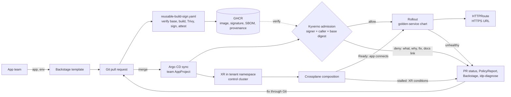
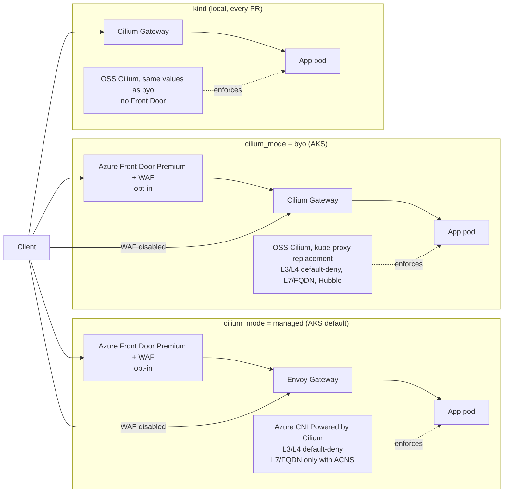
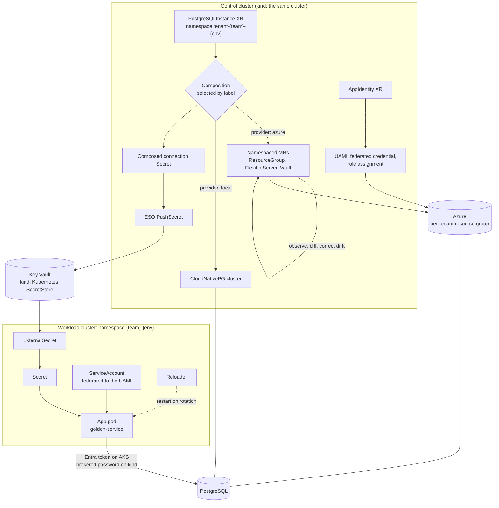

# Architecture

How the platform keeps the [Developer Contract](developer-contract.md), in three views: the path a change takes from a pull
request to a running app, the network path in each cluster profile, and how a dependency is reconciled and its credential
delivered. Each component is mapped to its promise and CNCF domain in the
[README matrix](../README.md#developer-contract-matrix); each choice is in the [Decision Log](adr/README.md). Every
diagram is rendered and syntax-checked by `scripts/verify-docs.sh` (check 4).

## 1. Developer Contract flow

A developer supplies only `app` and `env`. Every failure returns to Git with what failed and the next action. Nobody needs
`cluster-admin`.

## 2. Network traffic path: `managed` vs. `byo` vs. kind

Apps depend only on `HTTPRoute` and `CiliumNetworkPolicy`. The mode changes the `GatewayClass` and the dataplane, not the
app's manifests (D-005, D-027).

With the WAF enabled, Front Door reaches the gateway's internal load balancer through a Private Link origin, and a
direct request to the origin is refused ([ADR-0004](adr/0004-edge-security-and-waf.md)).

## 3. Crossplane external-resource reconciliation, including the ESO secret path

Deletion runs in reverse: `deletionPolicy: Delete`, Crossplane `Usage` for ordering, and the per-tenant resource group as
the blast-radius boundary. Kind is the one place the identity promise deviates (brokered password instead of federation;
[ADR-0008](adr/0008-application-workload-identity.md)).
